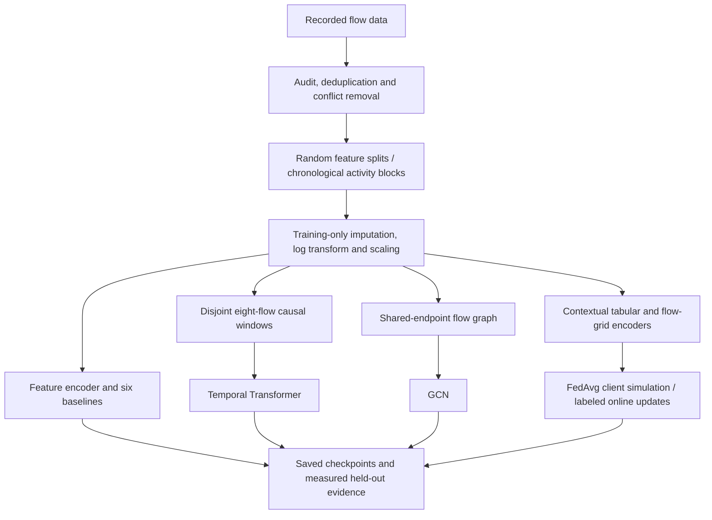
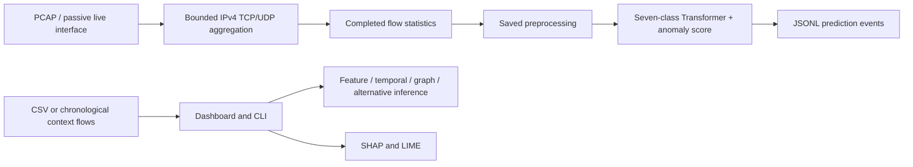

# FlowGuard architecture

The packet extractor is custom and has not been validated as CICFlowMeter-equivalent. PCAP replay is tested; physical live capture requires Npcap and suitable capture permissions. Classification does not block traffic. Context state is a flag-derived proxy. Adaptation requires real labels.
