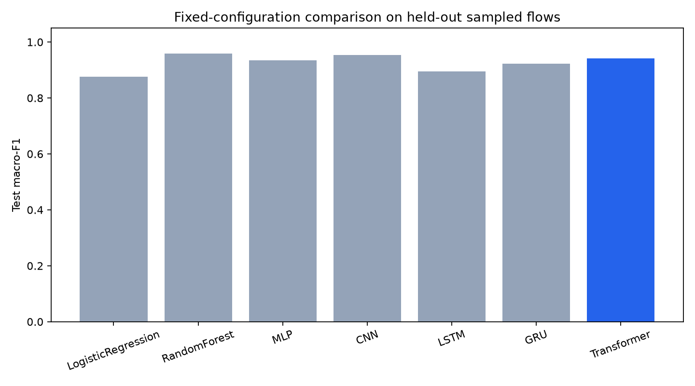
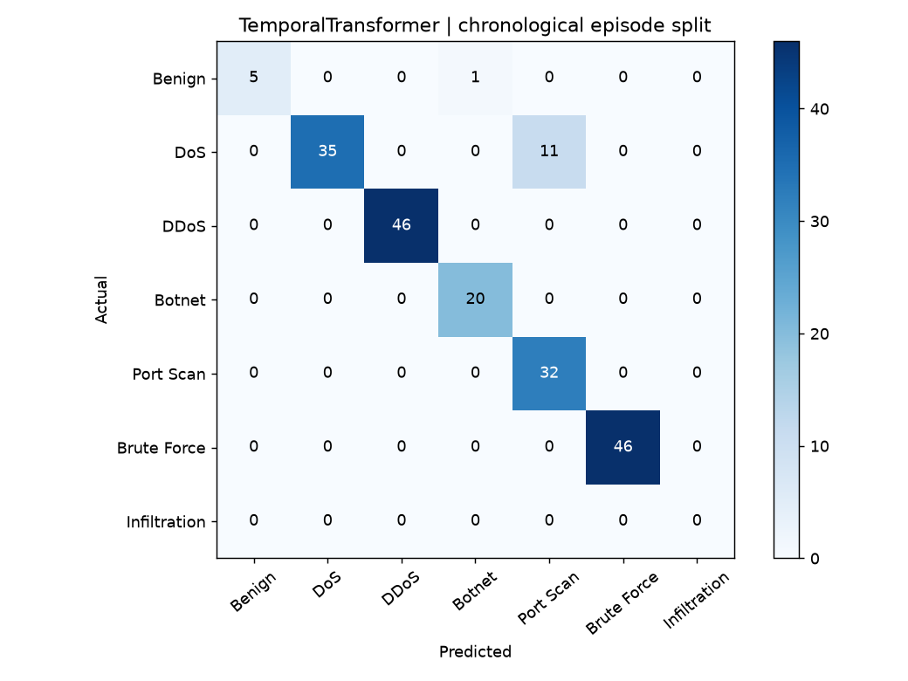

# Transformer-Based Network Intrusion Detection System for Intelligent Multi-Class Cyber Attack Classification

FlowGuard | Extended implementation and measured evaluation

## 1. Abstract and delivered scope

FlowGuard implements multi-class network intrusion classification with Transformer attention, chronological flow windows, network context, alternative attention models, graph learning, supervised adaptation and explainability. The local dashboard exposes saved models and measured evidence. A passive packet pipeline converts IPv4 TCP/UDP PCAP or interface traffic to completed flows and JSONL prediction events.

The seven-class feature Transformer achieved accuracy 97.02%, macro-F1 0.9409 and benign false-positive rate 4.44%. RandomForest achieved the highest macro-F1 (0.9588) in that declared benchmark. Temporal attention achieved accuracy 93.88% on 196 window endpoints, with no held-out infiltration window. These experiments measure historical sampled data, not production or zero-day reliability.

| Capability | Delivered evidence |
| --- | --- |
| Seven traffic classes | Benign, DoS, DDoS, Botnet, Port Scan, Brute Force, Infiltration |
| Attention architectures | Feature Transformer, temporal encoder, TabTransformer, flow-grid ViT, BERT-style encoder |
| Research extensions | Shared-endpoint GCN, local FedAvg, label-gated online updates, loss drift detector |
| Explainability | SHAP KernelExplainer, LIME Tabular, median-replacement sensitivity |
| Network pipeline | PCAP replay tested; physical live capture requires Npcap and remains unverified |
| Deliverables | Code, data samples, checkpoints, results, dashboard, report, slides, viva and tests |

Add student/team names, registration numbers, institution, guide and required declaration before submission. Dataset and architecture choices are acknowledged rather than presented as invented research.

## 2. Network problem and objectives

A bidirectional flow groups packets by endpoints, ports and protocol. Duration, direction, packet-size variation, inter-arrival times, byte/packet rates and TCP flags describe exchange behavior. DoS, DDoS, bot activity and scans may share flow statistics, so context across traffic can matter. FTP/SSH brute-force labels and infiltration labels add harder and rarer classes.

The objectives are to implement attention-based classification, compare traditional and neural baselines, test chronological feature context, expose explainable predictions, and integrate passive packet-to-flow processing. Each objective is accompanied by measured artifacts or an explicit runtime boundary. A supervised classifier still learns known labels; unusual traffic cannot automatically be called a novel attack.

The deployment path is a mirrored or monitored interface, passive packet collection, bounded flow aggregation, saved preprocessing, model inference and an alert log. Flow closing and idle/active timeout add latency. No traffic blocking or attack generation is part of this IDS.

## 3. Data acquisition, labels and audit

The extended feature benchmark audited 2,130,459 rows across six pinned c01dsnap/CIC-IDS2017 mirror CSVs. The contextual source contains 2,827,677 rows from rdpahalavan/CIC-IDS2017, revision eee96b6abc2c4bb621fd67679a4aa24bddc4be6a. Its SHA-256 is recorded in data/temporal/data_audit.json and checked by download/preparation scripts. Mirrors were not independently verified against original UNB PCAP files.

| Class | Feature sample | Train / validation / test |
| --- | --- | --- |
| Benign | 2998 | 2098 / 450 / 450 |
| DoS | 2000 | 1400 / 300 / 300 |
| DDoS | 2000 | 1400 / 300 / 300 |
| Botnet | 1229 | 860 / 184 / 185 |
| Port Scan | 1812 | 1268 / 272 / 272 |
| Brute Force | 1998 | 1399 / 300 / 299 |
| Infiltration | 34 | 24 / 5 / 5 |

DoS subtypes are grouped as DoS, Bot becomes Botnet, PortScan becomes Port Scan, and FTP-Patator/SSH-Patator become Brute Force. Unsupported labels are excluded, never silently relabeled Benign. Numeric-vector duplicates and conflicting labels are removed before splitting. Uniform class sampling modifies traffic prevalence.

Infiltration has only 34 selected feature vectors: 24 training, five validation and five test. A high score on five test examples is statistically weak. The listed assignment datasets are alternatives; this project uses CIC-IDS2017 and does not claim multi-dataset validation.

## 4. Preprocessing and split discipline

The feature benchmark uses 70/15/15 stratified random partitions after vector deduplication. Median imputation, signed log1p transformation and standardization are fitted only on training rows. The core five-class benchmark remains available as a reference. Related sessions may remain across those random partitions.

The contextual sample contains 15,574 unique selected-feature vectors. Source/day streams are separated into activity episodes using a 300-second idle gap. Each episode is split into chronological 70/15/15 blocks. Eight-flow windows never cross a split, source, day or idle gap; windows do not overlap. Sampling preserves timestamp order but omits intervening flows. Hosts/campaigns may still occur in several blocks.

The mirror encodes 12-hour clocks without AM/PM. A working-day heuristic shifts hours 01..07 by 12 hours, correcting 1,470,484 source timestamps. This assumption is recorded in the audit and has not been independently checked against original packets. Chronological conclusions depend on it.

| Class | Context train / validation / test | Temporal test endpoints |
| --- | --- | --- |
| Benign | 2568 / 506 / 1926 | 6 |
| DoS | 1749 / 375 / 376 | 46 |
| DDoS | 1750 / 375 / 375 | 46 |
| Botnet | 862 / 176 / 191 | 20 |
| Port Scan | 1265 / 271 / 275 | 32 |
| Brute Force | 1749 / 375 / 376 | 46 |
| Infiltration | 22 / 5 / 7 | 0 |

## 5. Inputs and network context

The base schema contains 24 duration, packet count/length, throughput, inter-arrival and TCP-flag statistics. See data/processed/feature_dictionary.csv for names, units and meanings. Extra labels are not prediction inputs. Invalid strings, missing columns and wholly unusable rows are rejected; missing cells use saved training medians.

| Additional input | Encoding and boundary |
| --- | --- |
| Source and destination port | Numeric 0..65535, log-scaled with other numeric inputs |
| Protocol | Unknown=0, TCP=1, UDP=2, ICMP=3; categorical tokens in TabTransformer |
| Source and destination IP | Private-status indicators and deterministic CRC32 buckets mod 256 |
| Raw IP addresses | Used for chronological host grouping and graph edges, not unbounded numeric addresses |
| Connection state | OPEN/CLOSED/RESET proxy inferred from FIN/RST counts; not full TCP reassembly |
| Timestamp | ISO local capture clock; used to order windows, not a predictive schedule feature |

Context models receive 32 numerical inputs. TabTransformer also receives protocol/state categorical tokens. IP buckets collide and can encode dataset-specific topology, so cross-network testing is essential.

## 6. Transformer and baseline implementations

| Model | Representation |
| --- | --- |
| Feature Transformer | Per-feature affine tokenization, CLS, two encoder layers, four heads, dimension 32 |
| Logistic Regression / Random Forest | Standardized 24-feature inputs; balanced class weights |
| MLP / CNN | Dense reference / convolutions over fixed feature order |
| LSTM / GRU | Recurrence over fixed feature order, not time |
| BERT-style encoder | Bidirectional feature tokens + CLS, trained from scratch on 32 context features |
| TabTransformer | Contextual attention over protocol/state embeddings concatenated with numerical features |
| Flow-grid ViT | Four-value numerical patches, learned positions, CLS, vision-style Transformer |

BERT-style describes an encoder architecture; it does not mean pretrained NLP BERT or masked-language pretraining. Flow-grid ViT uses numerical flow patches rather than screenshots or packet images. These representation choices are reproducible alternatives, not new architecture claims.

Feature benchmark neural training uses AdamW, learning rate .001, batch 256, weighted cross-entropy, gradient clipping 1, maximum 18 epochs and validation macro-F1 selection. Advanced architectures use batch 128, maximum ten epochs, early-stop patience four and one fixed configuration/seed. Parameter counts differ; the experiments are not exhaustive capacity-matched comparisons.

## 7. Seven-class benchmark results

| Model | Accuracy | Macro-F1 | Benign FPR |
| --- | --- | --- | --- |
| LogisticRegression | 93.71% | 0.8767 | 13.33% |
| RandomForest | 99.23% | 0.9588 | 0.89% |
| MLP | 97.68% | 0.9348 | 5.33% |
| CNN | 98.62% | 0.9539 | 2.22% |
| LSTM | 94.75% | 0.8946 | 13.56% |
| GRU | 96.13% | 0.9223 | 6.44% |
| Transformer | 97.02% | 0.9409 | 4.44% |

The feature Transformer selected epoch 6; accuracy was 97.02%. The report preserves the stronger Random Forest result rather than assuming attention improves every metric. Per-class reports, error flows, confusion matrices and training histories are in results/extended/. Single-seed historical scores do not establish operational superiority.

## 8. Chronological Temporal Transformer

A linear projection turns each contextual flow into a 32-dimensional token. Learned time positions and a causal attention mask connect earlier observations to the last flow. Two Transformer layers and a seven-class head classify the endpoint of a complete eight-flow window. No future flow within the window may influence an earlier hidden position.

The frozen temporal model was evaluated on 196 endpoints: accuracy 93.88%, macro-F1 across all seven labels 0.8003. Infiltration has zero temporal test support and benign has only six endpoints. Do not infer dependable infiltration detection or a stable benign false-positive estimate from this evaluation.

Temporal outputs differ from individual-flow outputs; their aggregate scores are not a like-for-like model ranking. Unit tests verify influence of history, timestamp ordering, idle-gap boundaries and disjoint window membership. Eight-flow context demonstrates sequence attention but does not prove all long-range traffic relationships are captured.

## 9. Context models and graph experiment

| Model | Accuracy | Macro-F1 | Test outputs |
| --- | --- | --- | --- |
| BERTStyleEncoder | 97.19% | 0.9111 | 3526 |
| TabTransformer | 95.09% | 0.8647 | 3526 |
| FlowViT | 95.26% | 0.8892 | 3526 |
| FlowGraphNetwork | 89.17% | 0.6782 | 3526 |
| TemporalTransformer | 93.88% | 0.8003 | 196 |
| FederatedFedAvg | 95.63% | 0.7984 | 3526 |
| OnlineLearning | 97.16% | 0.9189 | 3526 |

The graph experiment treats flows as nodes and creates edges when either endpoint IP matches an endpoint of another flow in the same consecutive 128-flow batch. Self loops and symmetric degree normalization feed a two-layer GCN. Graph construction never links different data splits. Predictions depend on supplied batch context, so a flow can receive different predictions in a different graph.

The chronological individual-flow tests contain seven infiltration examples; the temporal endpoint test contains none. Seven-label macro-F1 explicitly includes zero-support labels. The FedAvg and online rows have different training/adaptation protocols and should not be presented as controlled architecture rankings. Confusion matrices and saved checkpoint parity evidence accompany these results.

## 10. Federated and online-learning extensions

FedAvg partitions contextual training examples across three simulated IID clients. Each round runs two local epochs and aggregates model tensors weighted by client sample counts. Three fixed rounds produce a saved federated checkpoint. All clients execute locally; there is no distributed transport, secure aggregation, differential privacy or privacy guarantee.

| Round | Validation macro-F1 |
| --- | --- |
| 1 | 0.8402 |
| 2 | 0.8437 |
| 3 | 0.8491 |

Online learning starts from the validation-selected contextual encoder. Each chronological validation chunk is predicted before labels are revealed. One supervised update follows at a fixed .0001 learning rate. A Page-Hinkley detector observes chunk loss increases. The final adapted model is frozen and scored on test flows. Unverified predictions are not used as ground truth.

Prequential accuracy/loss/drift records are saved in results/advanced/online_prequential.csv. Drift arithmetic and weighted aggregation are tested, but real client heterogeneity and real-world concept drift remain unvalidated.

## 11. SHAP, LIME and anomaly flags

SHAP KernelExplainer uses 20 training reference rows and 128 coalition samples for the saved example. Reference probability 0.199805 plus attribution sum 0.799384 reconstructs predicted DDoS probability 0.999189. The raw attribution CSV is in results/explanations/shap.csv.

LIME Tabular uses 1,000 local perturbations and reports conditional feature weights. Its saved local-surrogate R-squared is 0.1440, which is poor fidelity; those weights should not support strong explanations. Both methods can be affected by correlated features and unrealistic perturbations. Median replacement remains a simpler sensitivity view. None is a causal explanation.

A benign-trained Isolation Forest adds anomaly_score and atypical_flag to extended-profile predictions. Its threshold is the validation-benign 99th percentile. Test benign false-alert rate is 1.11%; known-attack anomaly recall is only 1.98%. This weak result is preserved, and the atypicality flag is not presented as zero-day detection.

The dashboard computes actual SHAP/LIME explanations for the first held-out sample in the selected profile. Optional dependencies are listed in requirements-extensions.txt. Inputs are imputed with saved training medians before explanation.

## 12. Passive capture, replay and latency

monitor.py uses Scapy to read PCAP packets or passively sniff an interface. The bounded aggregator groups IPv4 TCP/UDP by bidirectional five-tuples, retains packet sizes/times rather than payload, and closes on FIN/RST, idle/active timeout or packet cap. Events contain network metadata, flow statistics, class probabilities, attack flag and anomaly score. A JSONL log is flushed after prediction batches.

The synthetic plumbing test contains 48 packets and emits 12 completed flows. Measured runtime was 0.207 seconds (58.0 flows/second), including extraction, inference and output on this tiny file. This is a small functional test, not a production throughput benchmark; no attack ground truth is attached.

The custom extractor uses IP packet lengths, population standard deviations and per-packet flag counts. Its semantics differ from CICFlowMeter. Completed-flow closing delays and feature shift prevent an inference timing result from proving real-time detection accuracy. Validate extraction equivalence, queue load and target-network false alerts before deployment.

Npcap is absent on this Windows computer. The interface capture path is implemented, but physical live capture could not be validated. Install the official driver, obtain capture permissions, list interfaces, run a bounded capture and review the events as documented in COMPLETE_PROJECT_GUIDE.md. IPv6 and fragmented transport reassembly are not implemented.

## 13. Verification, demonstration and reproduction

Automated checks cover strict inputs, training-only preprocessing, vector split separation, checkpoint parity, the original dashboard, extended profile and advanced model dashboard, temporal window membership, chronological boundaries, graph-edge influence, model output dimensions, FedAvg arithmetic, drift response and bidirectional packet aggregation. The full recorded verification output is results/VERIFICATION.txt.

Open OPEN_PROJECT.cmd; select Extended seven classes and classify included samples. Inspect model performance and per-class confusion counts. Open Extended lab, run a temporal/context model, compute SHAP/LIME, then replay the synthetic PCAP with monitor.py. The CSV demonstration includes at most ten held-out examples per class and is not a representative benchmark.

Source downloads are pinned by revision and hashes. Raw source files and virtual environments are excluded from the ZIP, while sampled data, saved preprocessing, checkpoints, labels, manifests and measured outputs are included. README documents preparation/training commands. Requirements-lock.txt records the tested environment. Model-only timings exclude capture/extraction; replay timing includes its pipeline work.

## 14. Conclusions and limits

The delivered project implements the principal Transformer NIDS, comparative models, chronological attention, contextual inputs, optional architecture variants, explainability, graph learning and supervised adaptation. A passive packet pipeline is runnable for PCAP replay and provides an interface capture path. Reported results are measured rather than invented.

Remaining validation concerns are physical live capture on a configured driver, extraction/domain-shift accuracy, independently verified original timestamps, stronger host/campaign holdouts, more rare infiltration sequences, multiple seeds/configurations, realistic federated clients and observed concept drift. A deployable production IDS, superior Transformer performance, research novelty and zero-day reliability have not been established.

The supplied research-gap/novelty statements are hypotheses and motivation. The experiment is a reproducible implementation of established ideas, with explicit evaluation boundaries. Institution-specific cover pages, approval, submission rules and student identity still require personalization.

## 15. References and acknowledgements

Sharafaldin, Lashkari and Ghorbani (2018). Toward Generating a New Intrusion Detection Dataset and Intrusion Traffic Characterization. https://www.unb.ca/cic/datasets/ids-2017.html

Vaswani et al. (2017). Attention Is All You Need. https://arxiv.org/abs/1706.03762

Gorishniy et al. (2021). Revisiting Deep Learning Models for Tabular Data. https://arxiv.org/abs/2106.11959

Huang et al. (2020). TabTransformer. https://arxiv.org/abs/2012.06678

Dosovitskiy et al. (2020). An Image Is Worth 16x16 Words. https://arxiv.org/abs/2010.11929

Devlin et al. (2018). BERT. https://arxiv.org/abs/1810.04805

Kipf and Welling (2016). Semi-Supervised Classification with Graph Convolutional Networks. https://arxiv.org/abs/1609.02907

McMahan et al. (2016). Communication-Efficient Learning of Deep Networks from Decentralized Data. https://arxiv.org/abs/1602.05629

Ribeiro et al. (2016). Why Should I Trust You? https://arxiv.org/abs/1602.04938

Lundberg and Lee (2017). A Unified Approach to Interpreting Model Predictions. https://arxiv.org/abs/1705.07874

SHAP KernelExplainer documentation. https://shap.readthedocs.io/en/stable/generated/shap.KernelExplainer.html

Scapy capture documentation. https://scapy.readthedocs.io/en/stable/usage.html ; Npcap: https://npcap.com/
